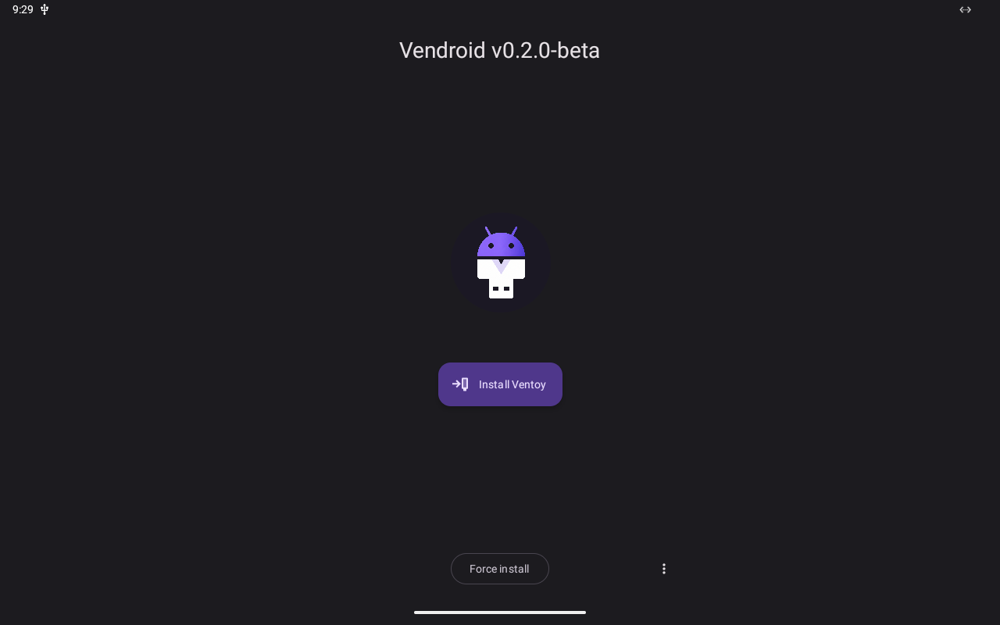
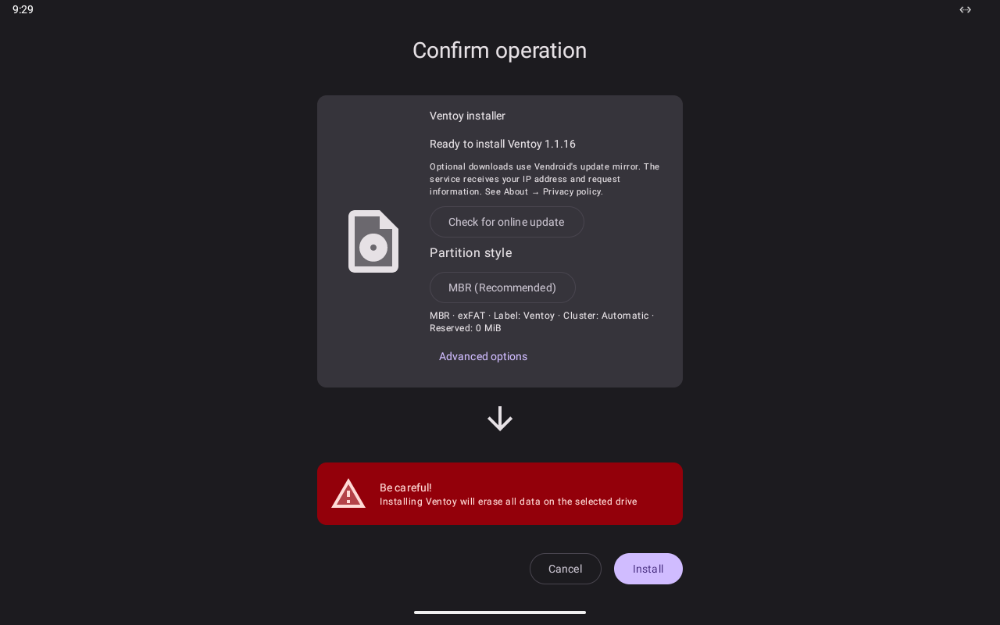
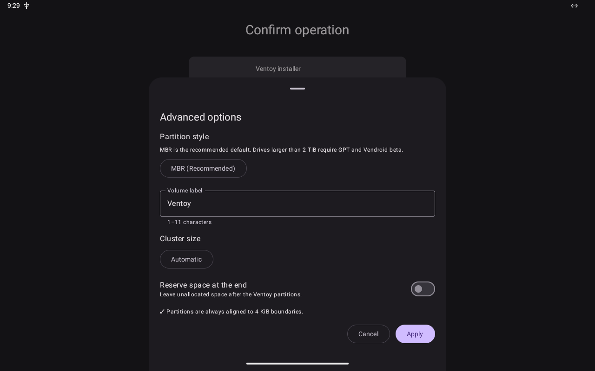

<p align="center">
  
</p>

<h1 align="center">Vendroid</h1>

<p align="center">
  Put <a href="https://www.ventoy.net">Ventoy</a> on a USB drive from your Android phone.<br>
  No root. No PC.
</p>

<p align="center">
  <a href="https://github.com/xntsO/Vendroid/releases"></a>
  <a href="https://github.com/xntsO/Vendroid/actions/workflows/build-test-debug.yml"></a>
  <a href="#google-play-beta"></a>
  
  <a href="LICENSE"></a>
</p>

<p align="center">
  <a href="#download-and-install">Download</a> ·
  <a href="#how-it-works">How it works</a> ·
  <a href="#limitations">Limitations</a> ·
  <a href="#faq">FAQ</a> ·
  <a href="https://vendroid.fhas.sa">Website</a>
</p>

---

Your PC will not boot, and the only working computer nearby is your phone. Vendroid turns a
USB drive into a [Ventoy](https://www.ventoy.net) multiboot drive straight from Android.
Install Ventoy once, copy ISO files onto the drive, and pick one from the Ventoy menu when
the computer starts.

> [!WARNING]
> Installing Ventoy erases the whole USB drive. Back it up first, and keep the drive
> connected until Vendroid says it is done.

**Status:** 0.2.0 is in beta. The stable 0.2.0 release follows once testing on a physical
drive is finished.

## Screenshots

<p align="center">
  <a href="docs/images/home.png"></a>
  <a href="docs/images/install-confirmation.png"></a>
  <a href="docs/images/install-options.png"></a>
</p>

These are real screens from the 0.2.0 beta. The automated tests capture them on a
tablet-sized Android virtual machine with a virtual USB drive. Phones show the same screens
in a portrait layout. See [docs/images](docs/images/README.md) for where they come from.

## Features

- **Install Ventoy** on a USB drive with an exFAT data partition.
- **Detect** an existing Ventoy drive and show its installed version.
- **Update** an older Ventoy drive. Only the boot parts are replaced, and your files stay.
- **Repair** a Ventoy drive that has the same version, again without touching your files.
- **Refuse downgrades.** Vendroid will not replace a newer or unknown Ventoy version with
  its own.
- **Works offline.** The official Ventoy 1.1.16 files are bundled and checked by SHA-256
  before use.
- **Optional online update.** Vendroid can download a newer official Ventoy package from its
  update mirror, verify its SHA-256, and keep it for later offline use.
- **Install options:** volume label, cluster size (automatic or 32 to 256 KiB), and
  unallocated space reserved at the end of the drive. Partitions are aligned to 4 KiB.
- **Checks its own work.** Vendroid flushes the drive and reads back what it wrote before it
  reports success.
- **No root.** Vendroid talks to the drive through Android's USB host API after you grant
  USB permission.
- **No ads, accounts, or analytics.** See the [privacy policy](docs/privacy-policy.md).
- English and Arabic, light and dark themes.

Vendroid does not copy ISO files for you. Use a computer, or a file manager on your phone
that can open the drive.

## How it works

1. **Raw USB access.** Android lets an app talk to a USB device directly once you allow it.
   Vendroid uses [libaums](https://github.com/magnusja/libaums) with an adapted SCSI driver
   to read and write the drive's sectors. Android never has to mount the drive, so root is
   not needed.
2. **Ventoy's layout.** Vendroid writes the layout Ventoy expects: a large exFAT partition
   for your files and a 32 MiB `VTOYEFI` partition at the end of the drive. Stable builds
   use an MBR partition table. The beta can also use GPT.
3. **Official boot files.** The boot code and the `VTOYEFI` image come from the official
   Ventoy Linux package. The build pins the version, and the app checks each file's SHA-256.
4. **Its own exFAT formatter.** Vendroid formats the data partition itself. CI checks the
   result with `fsck.exfat`.
5. **Flush and verify.** Vendroid asks the drive to flush its cache, then reads the
   partition table and boot files back and compares them.

Every change is tested in GitHub Actions on an Android virtual machine with virtual USB
drives: install, reconnect, update, repair, and booting a test ISO under both BIOS and UEFI
firmware. See the [validation guide](docs/validation.md).

## Download and install

You need:

- An Android 6.0 or newer device with USB host (OTG) support.
- A USB drive, and a USB-C or micro-USB adapter if the drive does not fit your phone.

### GitHub Releases

1. Open [Releases](https://github.com/xntsO/Vendroid/releases) and download the newest
   `vendroid-v<version>.apk`. Builds marked **Pre-release** are betas.
2. Open the APK on your phone and allow the installation when Android asks.

To check the download, compare it with the `.sha256` file published next to it:

```sh
sha256sum -c vendroid-v<version>.apk.sha256
```

Every release is signed with the same key. `apksigner verify --print-certs` shows this
certificate SHA-256:

```text
b388ad9d2290967480630cbd4a48f4f8c6784305c05da3541ad780821d9fbeb1
```

### Google Play beta

Vendroid is in closed testing on Google Play. To join:

1. Join the [vendroid-beta-testers](https://groups.google.com/g/vendroid-beta-testers)
   Google Group with the Google account you use on your phone.
2. Open the [opt-in page](https://play.google.com/apps/testing/io.github.xntso.vendroid),
   accept, and install Vendroid from Google Play.

Beta and stable are the same app, so the beta replaces a stable installation.

### Use it

1. Connect the USB drive and open Vendroid.
2. Tap **Install Ventoy**, pick the drive, and tap **Grant access**.
3. Check the drive name. Open **Advanced options** if you want to change the label, cluster
   size, or reserved space.
4. Tap **Install**. Vendroid asks you to lay the phone flat so the plug does not move.
   Wait for the success screen.
5. Copy your ISO files to the drive, plug it into the computer, and boot from USB.

If the drive already has partitions, Vendroid stops. Go back and choose **Force install**
to erase it. If the drive already has Ventoy, the confirmation screen offers **Update** or
**Repair** instead of **Install**, and your files are kept.

## Limitations

- **USB drives only.** The phone's built-in SD card slot is not supported.
- **Stable builds install MBR only.** GPT is experimental and available in the beta.
- **Drives larger than 2 TiB** need GPT, so they work only in the beta.
- **512-byte sectors only.** Drives that report another logical sector size are refused.
- **The data partition is exFAT.** FAT32, NTFS, and UDF are not available.
- **Secure Boot support cannot be turned off.** Ventoy's Secure Boot files are always
  installed. Booting with Secure Boot enforced is not covered by the automated tests yet.
- **Installing erases the drive.** Keeping existing files during a fresh install is not
  available.
- **No persistence, theme, or plugin setup,** and no way to use the phone itself as the
  boot drive.
- **Limited hardware testing.** Releases are tested on virtual drives and one physical USB
  drive. That does not prove every phone, drive, or computer works.

## FAQ

**Do I need root?**
No. Vendroid only needs the USB permission that Android asks you to grant.

**Can I use an SD card?**
Yes, in a USB card reader. The reader shows up as a normal USB drive. The phone's built-in
SD slot does not work, because Android does not let apps write to it as a raw device.

**Will I lose my files?**
A fresh install erases the whole drive. Update and repair keep your files, but back up
anything you cannot replace first.

**How do I get ISO files onto the drive?**
Copy them with a computer, or with a file manager on your phone that can open exFAT USB
drives. Vendroid does not copy files.

**Which ISO files boot?**
That is up to Ventoy, not Vendroid. See Ventoy's
[tested ISO list](https://www.ventoy.net/en/isolist.html).

**My drive is not found, or the operation stops halfway.**
Reconnect the drive and try again. A worn port, a bad adapter, or a phone that cannot give
the drive enough power can all cause this. Try another adapter or a powered hub.

**Does it need the internet?**
No. The bundled Ventoy package works offline. Vendroid connects only when you tap
**Check for online update**.

**Is this an official Ventoy app?**
No. Vendroid is an independent project that installs official Ventoy files.

**I found a bug.**
Please [open an issue](https://github.com/xntsO/Vendroid/issues/new/choose) with your
phone model, Android version, and USB drive.

## Build

Vendroid has one `foss` product flavor. It requires Java 17 and the Android SDK.

| Build type | Purpose |
| --- | --- |
| `fossDebug` | Development build. |
| `fossOptimized` | Minified build with debug signing, used by the automated tests. |
| `fossPreview` | The beta. Same package and name as stable, with `-beta` added to the version and GPT enabled. |
| `fossGptCandidate` | Stable package with GPT enabled, for testing before GPT moves to stable. |
| `fossRelease` | The stable release. |

The app bundles Ventoy `1.1.16`. CI rebuilds the pinned USB libraries for 16 KB pages
before Gradle resolves dependencies. These commands document the CI inputs:

```sh
mkdir -p .vendroid-cache
sdkmanager 'ndk;28.2.13676358' 'cmake;3.22.1'
python3 scripts/native/prepare.py --sdk-root "$ANDROID_HOME"
curl -fL -o .vendroid-cache/ventoy-1.1.16-linux.tar.gz \
  https://github.com/ventoy/Ventoy/releases/download/v1.1.16/ventoy-1.1.16-linux.tar.gz
./gradlew assembleFossDebug
```

Builds, unit tests, lint, and Appium/QEMU tests run in GitHub Actions on every pull request
to `main`. Signed release APKs require the repository signing secrets described in
[AGENTS.md](AGENTS.md). See [Google Play publishing](docs/google-play.md) for the release
process and version codes, and [Native USB libraries](docs/native-16kb.md) for the 16 KB
rebuild.

## Contributing

Bug reports and device reports are welcome, especially from phones, drives, and computers
that have not been tried yet. Use the
[issue forms](https://github.com/xntsO/Vendroid/issues/new/choose).

For pull requests:

- Keep one concern per pull request, with atomic
  [Conventional Commit](https://www.conventionalcommits.org) messages.
- Rebase onto `main`. Do not merge `main` into your branch.
- Add or extend tests for any behavior you change. Storage fixes need a regression test.
- GitHub Actions is the verification environment. All checks must pass before merge.

[AGENTS.md](AGENTS.md) and the [validation guide](docs/validation.md) have the details.

## License and credits

Vendroid is free software under the [GNU GPLv3](LICENSE), copyright © 2026 Faisal Sumayli
and Vendroid contributors. It comes with no warranty. [NOTICE](NOTICE) lists every credit.
Third-party components keep their own licenses.

- [Ventoy](https://github.com/ventoy/Ventoy) is the bootloader Vendroid installs. Vendroid
  ships its official release files and is not affiliated with the Ventoy project.
  Ventoy is GPLv3 software and contains other free software such as GRUB 2 and BusyBox.
  The bundled Ventoy 1.1.16 is built from tag
  [`v1.1.16`](https://github.com/ventoy/Ventoy/tree/v1.1.16), commit
  [`2f66a309e4a3f0e08953aabfb0f1cf7e12b39f5d`](https://github.com/ventoy/Ventoy/commit/2f66a309e4a3f0e08953aabfb0f1cf7e12b39f5d).
  Its license texts are in [`third_party/ventoy/License`](third_party/ventoy/License) and in
  the app. Every [Vendroid release](https://github.com/xntsO/Vendroid/releases) carries a
  copy of that source and of the BusyBox source. [Licensing](docs/licensing.md) has the details.
- Vendroid is a modified version of [EtchDroid](https://github.com/EtchDroid/EtchDroid),
  © Davide Depau and contributors, GPLv3. It was derived from EtchDroid commit
  [`e2eda57136d4`](https://github.com/EtchDroid/EtchDroid/tree/e2eda57136d46fd3c465dee2e5ab31cdcb019a6e)
  on 2026-07-04 and has been changed since.
- [libaums](https://github.com/magnusja/libaums) provides USB mass-storage access, together
  with [libusb](https://libusb.info).
